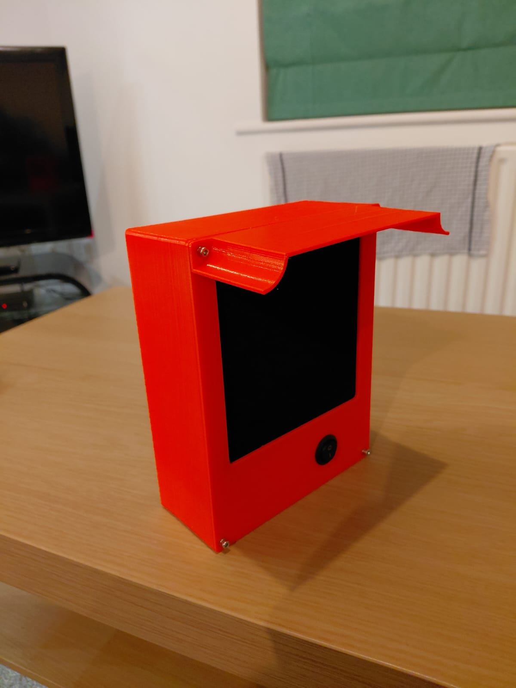

# Extractor Fan
This is a design and BOM for a 3D printed extractor fan for soldering.

## CAD 
The STL files for the case, lid and hood are given. The hood is optional but may help prevent fumes escaping. I may create new hood variants. I printed them in PETG with a Prusa MK3S printer but they could be printed by any reasonable 3D printer in PLA, PETG or any other material in your cupboard.

## BOM
Fan: [JZK 120x120x38mm DC 24V 2 pin brushless cooling fan 12cm, 0.18A, 3100 rpm, 12038 dual-ball bearing DC fan 120mm for ice machine, fan heater, cooler, PC case fan](https://www.amazon.co.uk/dp/B0C69GDRW2?ref=ppx_yo2ov_dt_b_fed_asin_title)

Filters: [Hakko A1001 Filters for The FA400 / 493 (Set of 5)](https://www.amazon.co.uk/dp/B004OCSCO6?ref=ppx_yo2ov_dt_b_fed_asin_title)

Power connector: [COOLM DC Power Jack Socket Threaded Female Mount Connector Adapter 5.5mm 2.1mm and Male Pigtail Barrel Connector Cable 18AWG with Dustproof Plug (2Pairs)](https://www.amazon.co.uk/dp/B0CZT24S48?ref=ppx_yo2ov_dt_b_fed_asin_title)

Switch: [Mini Round Rocker Switch AC 6A/250V 10A/125V, Black 5 Pcs](https://www.amazon.co.uk/dp/B0C69GDRW2?ref=ppx_yo2ov_dt_b_fed_asin_title)

Power Block: 24V barrel Jack with 2.1mm pin, I had one lying around so cannot give a recommendation

Heat Inserts: M3, I have a packet lying around so cannot give a recommendation but any would do

Bolts: M3, I have a packet lying around so cannot give a recommendation but any would do

These are just the options I used, I am sure they could be optimised for price or performance.

## Equipment
Soldering Iron, Solder, Flux

Heat gun, heat shrink

Wire Stripper, Wire cutter

3D printer

## Process
1. Print all the STL files
2. Insert the switch into the lid
3. Insert the barrel jack into the case
4. Insert the fan ensuring the wires come through the slot into the bottom compartment
5. Cut the connector off the fan, solder the red wire to the connector red wire and the black wire to the switch
6. Solder the black wire of the barrel jack to the switch
7. Heat gun the heat shrink on all the wire-wire and wire-switch connections
8. Insert the heat inserts with the soldering iron into the case
9. Attach with bolts the lid and hood to the case
10. Get soldering!
